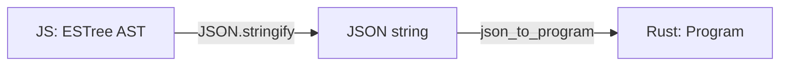

# Oxc ESTree Codec

Read ESTree JSON into oxc's typed Rust AST.

## Usage

The codec works across a string boundary: the JS side serializes an ESTree AST with `JSON.stringify`, and the Rust side reads that JSON string into a typed [`oxc`](https://docs.rs/oxc) `Program`.



**JS → Rust**: read an ESTree JSON string into a typed AST:

```ts
const json: string = JSON.stringify(ast); // ESTree AST → JSON string
```

```rust
use oxc::allocator::Allocator;
use oxc::ast::ast::{Program, SourceType};
use oxc_estree_codec::{JsonToProgramOptions, json_to_program};

let json: &str = r#"{"type":"Program","body":[...],"sourceType":"module"}"#;

let allocator: Allocator = Allocator::default();

let source_text: &str = "const x = 1;";

let program: Program<'_> = json_to_program(
    json,
    JsonToProgramOptions {
        allocator: &allocator,
        source_type: SourceType::from_path("index.js").unwrap(),
        source_text,
    },
)?;
```

## Contributing

For contributing, please refer to the [contributing guide](./CONTRIBUTING.md).

## License

This project is licensed under the terms of the MIT license.
